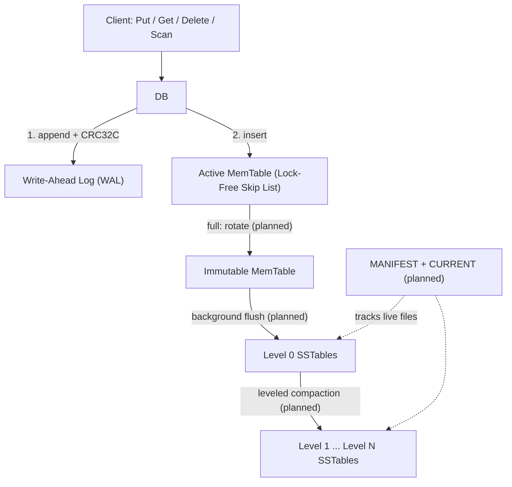

# lsm-store

An educational **Log-Structured Merge-tree (LSM)** key-value storage engine implemented from scratch in Go using **only the standard library**.

> **Status:** Actively in progress — MemTable, WAL, crash recovery, and core `DB` are implemented; SSTables, Bloom filters, and leveled compaction are next. This is a learning & systems-programming portfolio project, not intended for production use.

---

## Why This Project?

This repository explores storage engine internals and advanced Go concepts without relying on third-party libraries:

- **Lock-free concurrency & the Go memory model:** Single-writer, lock-free multi-reader generic skip list (`SkipList[K, V]`) using `atomic.Pointer` and bottom-up node publication.
- **Durability & crash recovery:** Append-only Write-Ahead Log (WAL) with Castagnoli CRC32C framing, torn-tail recovery & truncation on reopen, and `syscall.Flock` directory locking.
- **Binary encoding & allocation awareness:** Zero-allocation hot paths (`0 allocs/op` for parallel skip-list reads, key comparison, and WAL record framing) using `encoding/binary`, varints, and append-style APIs.
- **Rigorous verification:** Race detector (`-race`), property/model-based fuzzing (`go test -fuzz`), and re-exec subprocess crash-recovery tests (`os.Args[0]`).

---

## Architecture



### Internal Key Encoding

Because an LSM-tree never overwrites data in place, multiple versions (and deletion tombstones) of the same key coexist. Every entry is encoded as:

```
+------------------------+------------------------------------+
|  user key (N bytes)    |  trailer (8 bytes, little-endian)  |
+------------------------+------------------------------------+
                            trailer = (seq << 8) | kind
                            seq: 56 bits    kind: 8 bits (DEL=0, SET=1)
```

Keys are ordered by **user key ascending, then trailer descending**, so the newest version of any key always sorts first. A point lookup becomes a single `SeekGE(userKey, seq)` followed by checking the user key and tombstone kind.

---

## Usage

```go
package main

import (
	"errors"
	"fmt"
	"log"

	lsm "github.com/elvan/lsm-store"
)

func main() {
	opts := lsm.DefaultOptions()
	opts.SyncWrites = true // fsync WAL on every write

	db, err := lsm.Open("./data", opts)
	if err != nil {
		log.Fatal(err)
	}
	defer db.Close()

	if err := db.Put([]byte("apple"), []byte("red")); err != nil {
		log.Fatal(err)
	}

	val, err := db.Get([]byte("apple"))
	if err != nil {
		log.Fatal(err)
	}
	fmt.Println(string(val)) // red

	if err := db.Delete([]byte("apple")); err != nil {
		log.Fatal(err)
	}

	_, err = db.Get([]byte("apple"))
	fmt.Println(errors.Is(err, lsm.ErrNotFound)) // true
}
```

---

## Project Structure

Packages under `internal/` form a strict acyclic dependency graph with zero external dependencies:

```
lsm-store/
├── db.go                 # Public API: Open, Put, Get, Delete, Close, WAL replay, LOCK
├── options.go            # Configurable Options with zero-value defaults
├── errors.go             # Public sentinel errors & size limits
├── db_test.go            # CRUD, concurrency, dir-lock, and re-exec crash-recovery tests
└── internal/
    ├── keys/             # Internal key binary encoding, decoding & comparator
    ├── skiplist/         # Generic SkipList[K, V] with lock-free concurrent reads
    ├── memtable/         # In-memory sorted write buffer with visibility semantics
    ├── wal/              # CRC32C-framed record log, batch encoding, torn-tail recovery
    └── sstable/          # (In progress) Block-based SSTable writer, reader & sparse index
```

---

## Roadmap

- [x] **M0:** Project scaffold, options & sentinel errors
- [x] **M1:** Internal key binary format & comparator (with fuzzing)
- [x] **M2:** Generic lock-free-read skip list (`atomic.Pointer`) & MemTable
- [x] **M3:** Write-Ahead Log (CRC32C framing, batch encoding, torn-tail recovery)
- [x] **M4:** DB v1 (`Open`/`Put`/`Get`/`Delete`/`Close`, `LOCK` file, WAL replay & crash tests)
- [x] **M5:** SSTables (4 KiB CRC-checked blocks, sparse index, `io.ReaderAt`, iterator) *(in progress)*
- [x] **M6:** Bloom filters (double hashing) integrated into SSTables
- [ ] **M7:** Background MemTable flush, `MANIFEST` / `CURRENT`, reference-counted versions
- [ ] **M8:** Heap-based merging iterator & level iterator
- [ ] **M9:** Background leveled compaction & model-based randomized testing
- [ ] **M10:** Public range `Scan(start, end)` using `iter.Seq2`

---

## Testing & Benchmarks

Run the full test suite with the race detector (includes subprocess crash-recovery tests):

```bash
go test -race ./...
```

Run fuzz targets (model-based skip list verification, binary decoders, WAL reader):

```bash
go test -run=NONE -fuzz=FuzzAgainstModel -fuzztime=20s ./internal/skiplist
go test -run=NONE -fuzz=FuzzBatchDecode  -fuzztime=20s ./internal/wal
go test -run=NONE -fuzz=FuzzReader       -fuzztime=20s ./internal/wal
go test -run=NONE -fuzz=FuzzCompare      -fuzztime=20s ./internal/keys
```

### Sample Benchmarks

Measured on AMD Ryzen 5 7600 (Linux amd64, Go 1.27):

| Benchmark | Time | Memory | Allocs |
|---|---:|---:|---:|
| `keys.BenchmarkCompare` | 3.3 ns/op | 0 B/op | 0 allocs/op |
| `skiplist.BenchmarkGet` (100k keys) | 231 ns/op | 0 B/op | 0 allocs/op |
| `skiplist.BenchmarkGetParallel` (12 threads) | 22.8 ns/op | 0 B/op | 0 allocs/op |
| `skiplist.BenchmarkInsert` | 989 ns/op | 58 B/op | 2 allocs/op |
| `memtable.BenchmarkAdd` | 1,775 ns/op | 218 B/op | 3 allocs/op |
| `wal.BenchmarkWriteRecord` | 22.9 ns/op | 0 B/op | 0 allocs/op |
| `wal.BenchmarkBatchEncode` (10 entries) | 53.5 ns/op | 0 B/op | 0 allocs/op |
| `wal.BenchmarkBatchDecode` (10 entries) | 139 ns/op | 576 B/op | 1 allocs/op |

---

## License

MIT
